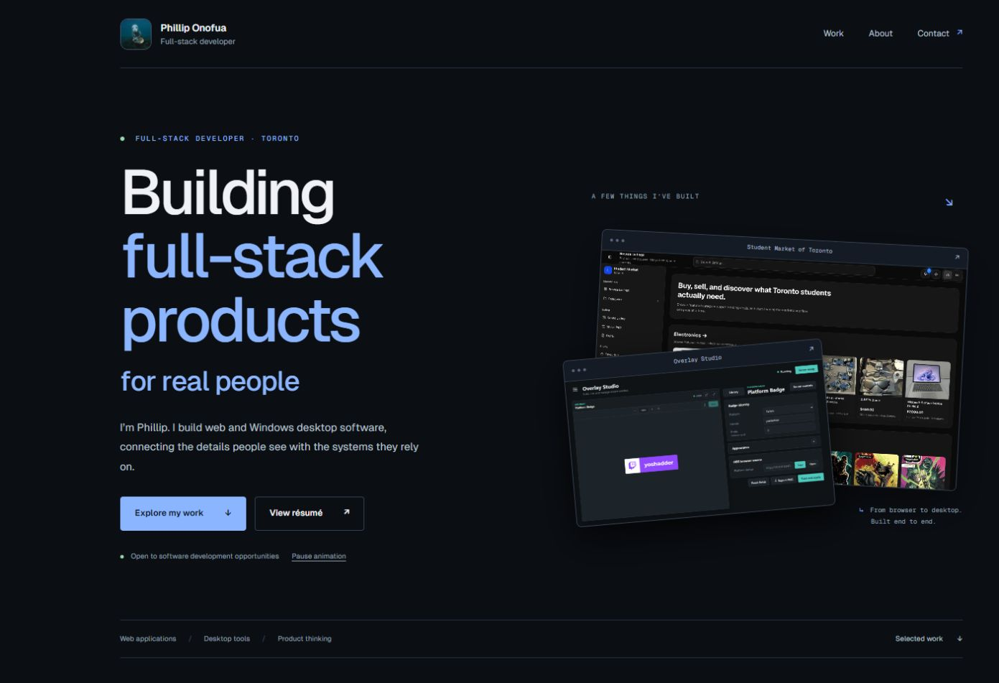

# Phillip Onofua | Full-Stack Developer Portfolio

A responsive portfolio presenting my full-stack web, Windows desktop, and product-development work.

[View the live portfolio](https://philliponofua.vercel.app) · [Download my résumé](https://philliponofua.vercel.app/assets/phillip-onofua-resume.pdf)



## Overview

This repository contains the source for my personal portfolio. The homepage pairs a letter-by-letter animated headline and skills-focused introduction with product previews, direct résumé access, two detailed case studies, an Android prototype, and a live interactive 3D collection.

The portfolio is intentionally lightweight: it uses static HTML, CSS, and JavaScript, has no runtime dependencies, and deploys directly from the `main` branch.

## Featured work

### Student Market of Toronto

An end-to-end student marketplace connecting catalogue discovery, listing management, messaging, profiles, media storage, and protected moderation workflows.

The case study opens with the working interface, a summary of the problem and my contribution, and grouped galleries covering marketplace, messaging, profiles, administration, mobile interfaces, and the data model. The engineering sections explain request-scoped authentication, bounded server-rendered queries, recoverable listing writes, realtime communication, and auditable report review. An expandable technical-notes section preserves the deeper implementation detail.

- **Role:** Team lead of a five-person team and full-stack developer
- **Stack:** Next.js, React, Supabase, PostgreSQL, and Tailwind CSS
- **Demo hosting:** Vercel
- [Open the live project](https://student-market-of-toronto.vercel.app)
- [View the source code](https://github.com/EdoiseO/student-market-of-toronto)
- [Read the engineering case study](https://philliponofua.vercel.app/student-market.html)
- [Read current deployment limitations](https://github.com/EdoiseO/student-market-of-toronto/blob/main/docs/deployment.md)

### Overlay Studio

A Windows desktop application for managing reusable overlay instances, customizing their appearance, previewing live data, and preparing browser-source URLs for OBS.

The case study covers the twelve-overlay library, audio-reactive animation, request pacing, local-server security, privacy, packaging, a recorded demonstration, and code highlights explaining how draft previews and saved output stay separate. Its hardest-problem section is a marked placeholder for a future personal account.

- **Role:** Product designer and developer
- **Stack:** Python, JavaScript, aiohttp, WebSockets, WebView2, and OBS Studio
- **Status:** Working desktop application in active development
- [Explore how Overlay Studio works](https://philliponofua.vercel.app/overlay-studio.html)
- [Watch the demonstration](https://philliponofua.vercel.app/overlay-studio.html#overlay-demo)

### Restaurant Guide

An Android team prototype built with Kotlin and Jetpack Compose for browsing restaurant details, photos, ratings, and visit notes. Its records currently use session and saved UI state; durable storage is planned.

- **Role:** Lead developer
- **Stack:** Kotlin, Jetpack Compose, and Android
- [View the source](https://github.com/EdoiseO/COMP3074-RestaurantGuide)

### Off the clock

A live interactive 3D comic collection built with Three.js. Visitors can open the box, browse the collection, and inspect the covers up close.

- **Stack:** JavaScript and Three.js
- [Explore the collection](https://philliponofua.vercel.app/off-the-clock/)

The [Receipt Splitter concept](https://philliponofua.vercel.app/receipt-splitter.html) remains available separately as work in exploration.

## Portfolio features

- Dark-only, responsive editorial layout with clear navigation
- **Off the clock:** an interactive 3D comic collection with a movable lid, glossy sleeves, separate backing boards, verified rear artwork, close-up rotation, and a gentle hover/glow
- Letter-by-letter headline animation, product previews, and prominent résumé access
- Quick links to web, desktop, mobile, and 3D projects, plus grouped language skills
- Animation pause control, reduced-motion support, and a readable fallback without JavaScript
- Two detailed projects using real product captures, plus a live interactive 3D collection
- Restaurant Guide design gallery and a compact row of smaller builds
- Dedicated case-study pages with project-specific metadata and social previews
- Product-first Student Market case study with expandable technical notes
- Student Market workflow galleries with thumbnails, image zoom, and full-size viewing
- Overlay Studio screenshots and a recorded product demo near the top of its case study
- Semantic HTML, skip links on the refreshed pages, visible keyboard focus, descriptive alternative text, and reduced-motion support
- Downloadable résumé, direct contact links, privacy policy, and terms of use

## Built with

- HTML5
- CSS3
- Vanilla JavaScript
- HTML Dialog API
- Self-hosted Three.js for the Off the clock collection
- Vercel

There is no package installation or build step. All required fonts, images, logos, scripts, and media are committed with the site.

## Run locally

```bash
git clone https://github.com/EdoiseO/phillip_onofua.git
cd phillip_onofua
python3 -m http.server 8000
```

Open [http://localhost:8000](http://localhost:8000).

## Repository structure

```text
.
├── index.html                         # Portfolio homepage
├── off-the-clock/                     # Self-contained 3D comic collection
├── student-market.html                # Student Market engineering case study
├── overlay-studio.html                # Overlay Studio product case study
├── receipt-splitter.html              # Work-in-progress product plan
├── privacy.html                       # Privacy policy
├── terms.html                         # Terms of use
├── public/assets/
│   ├── styles.css                     # Base presentation styles
│   ├── overrides.css                  # Shared case-study and supporting-page styles
│   ├── home.css                       # Self-contained responsive homepage styles
│   ├── hero-motion.js                 # Letter animation and motion preferences
│   ├── case-study-refresh.css         # Student Market product-first layout and technical notes
│   ├── student-market-gallery.js      # Student Market gallery and zoom interactions
│   ├── student-market-*.{png,jpg}     # Desktop, mobile, admin, and data-model captures
│   ├── overlay-studio-*.png           # Overlay Studio interface captures
│   ├── overlay-studio-demo.webm       # Recorded Overlay Studio demonstration
│   ├── restaurant-guide/              # Replaceable Restaurant Guide design screenshots
│   ├── tech-logos/                    # Self-hosted technology brand marks
│   ├── portfolio-preview.jpg          # README and social preview image
│   └── phillip-onofua-resume.pdf      # Downloadable résumé
└── README.md
```

## Deployment

Vercel deploys the production site from the `main` branch.

Vite builds the site into `dist/`. The HTML pages keep their own entry points
and `public/` keeps shared assets at their original URLs. Off the clock ships
as a separate static page with its vendored Three.js scene.

Privacy, Terms, Receipt Splitter and Overlay Studio render from React components
in `src/pages/`. Vite inserts the rendered HTML at build time so these pages
can load and work without a client JavaScript bundle.

```sh
npm ci
npm run build
npm run preview
```

Use `npm run dev` while editing the Vite pages. Use the built preview to check
the deployed output and its security headers.

### Browser security

`vercel.json` applies a Content Security Policy, MIME-sniffing and framing protection, a referrer policy, and restrictions on unused browser permissions to every route. Vercel supplies HSTS. Scripts, styles, fonts, media, and connections are same-origin; image textures may also use data/blob URLs. The sole inline script is the hash-approved Three.js import map. If that map changes, update its SHA-256 in the policy. No `unsafe-inline` or `unsafe-eval` exception is required. Browser styling uses CSSOM properties rather than inline style blocks.

Run `npm test` to check the headers, HTML scripts, and Off the clock scene.
After a build, the security test also checks the HTML in `dist/`.

The October 22, 2026 advisory check found no GitHub advisory matches for the vendored Three.js `0.186.0` (r186). [CVE-2020-28496](https://github.com/advisories/GHSA-fq6p-x6j3-cmmq) affects versions below `0.125.0`; [CVE-2022-0177](https://github.com/advisories/GHSA-7vvq-7r29-5vg3) is withdrawn and listed versions below `0.137.0`. This is a point-in-time advisory check, not a guarantee against undisclosed vulnerabilities. The vendored files are not covered by npm audit; recheck advisories when updating them.

Technology brand marks are sourced from [Devicon](https://devicon.dev) and [Simple Icons](https://simpleicons.org). The document and external-link symbols are from [Bootstrap Icons](https://icons.getbootstrap.com). All trademarks belong to their respective owners.

## Contact

- [GitHub](https://github.com/EdoiseO)
- [Email](mailto:phillip.onofua@gmail.com)

## Off the clock

The collection at `/off-the-clock/` is imported from the approved Short Box prototype, commit `241a5afaba0734fc72a39c3aa32fdd413fb31f9e`. Its 24 editions, cover sources, physical model, sleeve interactions, and reduced-motion support are preserved. The page and all textures, fonts, and Three.js modules are served from this repository; the homepage does not load the 3D assets.

Collection metadata is a saved snapshot. It includes no inventory order details or prices. Rear imagery is verified for 22 of 24 entries (21 actual comic backs and one mystery-bag wrapper); Ben 10 #2 Cover F packaging and incoming Absolute Green Arrow #6 remain clearly marked unavailable. Artwork remains credited to its original sources in `off-the-clock/comics.js`; the Three.js license is included in `off-the-clock/vendor/THREE-LICENSE.txt`.

## How I built this

I designed and built this portfolio with AI coding assistants (ChatGPT/Codex and Claude) to speed up implementation and review; I am responsible for the architecture and can walk through the code.
