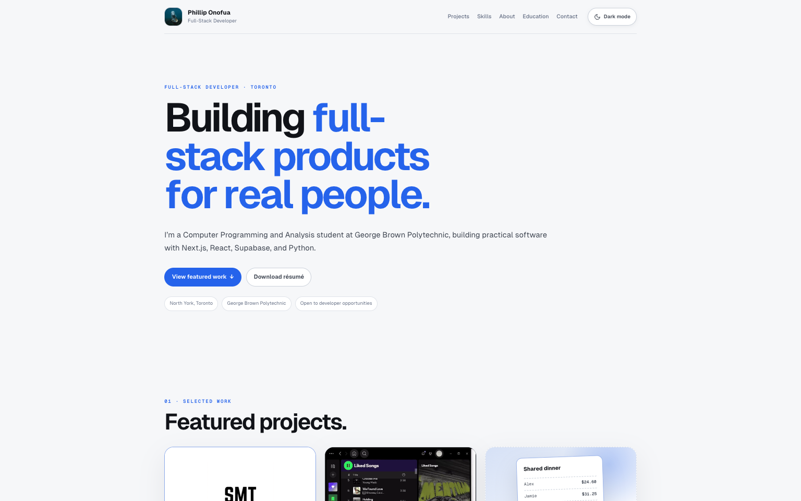

# Phillip Onofua | Full-Stack Developer Portfolio

A responsive portfolio presenting my full-stack web, Windows desktop, and product-development work.

[View the live portfolio](https://philliponofua.vercel.app) · [Download my résumé](https://philliponofua.vercel.app/assets/phillip-onofua-resume.pdf)



## Overview

This repository contains the source for my personal portfolio. The site introduces selected work through an editorial homepage and links each project to a dedicated case study with implementation details, real interface captures, and clear status information.

The portfolio is intentionally lightweight: it uses static HTML, CSS, and JavaScript, has no runtime dependencies, and deploys directly from the `main` branch.

## Current work

**6 September 2026:** the refreshed Student Market case study is prepared on `agent/student-market-case-study-refresh` in [draft PR #3](https://github.com/EdoiseO/phillip_onofua/pull/3). [View the hosted review preview](https://philliponofua-1tjv54dla-edoise-o.vercel.app/student-market.html). The live portfolio still shows the previous version.

The case study separates fresh captures of the live guest catalogue from the implemented moderation preview with demonstration data. Student Market's application rollout is a separate release and remains pending hosted verification. See the [refresh notes](docs/student-market-refresh.md) for screenshot sources, validation evidence, and publication status.

## Featured work

### Student Market of Toronto

An end-to-end student marketplace connecting catalogue discovery, listing management, messaging, profiles, media storage, and protected moderation workflows.

The visual case study leads with the student experience and explains three engineering decisions: recoverable listing writes, consistent realtime conversations, and explicit review authority. Four September captures show the live guest catalogue and the implemented mobile moderation preview. Earlier workflow galleries remain available, with image zoom and direct-image fallbacks. The page dates its 322-test validation evidence and distinguishes the release preview from the current live demo.

- **Role:** Team lead and full-stack developer
- **Stack:** Next.js, React, Supabase, PostgreSQL, Tailwind CSS, and Vercel
- [Open the live project](https://student-market-of-toronto.vercel.app)
- [View the source code](https://github.com/EdoiseO/student-market-of-toronto)
- [Read the engineering case study](https://philliponofua.vercel.app/student-market.html)

### Overlay Studio

A Windows desktop application for managing reusable overlay instances, customizing their appearance, previewing live data, and preparing browser-source URLs for OBS.

The case study shows the instance library, live customizers, Windows media integration, grouped social overlays, persistent settings, and a recorded product demonstration.

- **Role:** Product designer and developer
- **Stack:** Python, JavaScript, aiohttp, WebSockets, WebView2, and OBS Studio
- **Status:** Working production application in active development
- [Explore how Overlay Studio works](https://philliponofua.vercel.app/overlay-studio.html)

### Receipt Splitter

A work-in-progress mobile product concept for assigning shared receipt items, tax, and tip and producing clear totals for each person.

The project page separates the concept from finished work and documents the problem, proposed verification flow, open technical decisions, and next development milestones.

- **Status:** Concept and workflow definition
- [Review the Receipt Splitter plan](https://philliponofua.vercel.app/receipt-splitter.html)

## Portfolio features

- Dark-only, responsive editorial layout with sticky navigation
- Animated hero phrase with a static screen-reader label and reduced-motion support
- Alternating featured-project layouts using real product captures
- Dedicated case-study pages with project-specific metadata and social previews
- Student Market product walkthrough, visible mobile moderation captures, and expandable engineering decisions
- Workflow galleries with thumbnails, image zoom, keyboard navigation, focus restoration, and direct-image fallbacks when JavaScript is unavailable
- Overlay Studio screenshots and an embedded product demo
- Semantic HTML, visible keyboard focus, descriptive alternative text, and accessible controls
- Downloadable résumé, direct contact links, privacy policy, and terms of use

## Built with

- HTML5
- CSS3
- Vanilla JavaScript
- Web Animations API
- Intersection Observer API
- HTML Dialog API
- Vercel

There is no package installation or build step. All required fonts, images, logos, scripts, and media are committed with the site.

## Run locally

```bash
git clone https://github.com/EdoiseO/phillip_onofua.git
cd phillip_onofua
python3 -m http.server 8000 --bind 127.0.0.1
```

Open [http://localhost:8000](http://localhost:8000).

The clone starts on `main`. To review the September refresh locally, check out `agent/student-market-case-study-refresh` and open [the Student Market page](http://localhost:8000/student-market.html). Python 3 is only used for this local server; the deployed site has no Python runtime or build step.

## Repository structure

```text
.
├── index.html                         # Portfolio homepage
├── student-market.html                # Student Market engineering case study
├── overlay-studio.html                # Overlay Studio product case study
├── receipt-splitter.html              # Work-in-progress product plan
├── privacy.html                       # Privacy policy
├── terms.html                         # Terms of use
├── assets/
│   ├── styles.css                     # Base presentation styles
│   ├── overrides.css                  # Current layout, responsive, and case-study styles
│   ├── student-market-case-study.css  # Styles scoped to the Student Market page
│   ├── student-market-gallery.js      # Student Market gallery and zoom interactions
│   ├── student-market-*-sep2026.png    # Four fresh catalogue and moderation captures
│   ├── student-market-*.{png,jpg}      # Earlier workflow and data-model captures
│   ├── overlay-studio-*.png           # Overlay Studio interface captures
│   ├── overlay-studio-demo.webm       # Recorded Overlay Studio demonstration
│   ├── tech-logos/                    # Self-hosted technology brand marks
│   ├── portfolio-preview.png          # README and social preview image
│   └── phillip-onofua-resume.pdf       # Downloadable résumé
├── docs/
│   └── student-market-refresh.md      # Capture provenance, checks, and release notes
└── README.md
```

## Updating the case studies

Edit each project's HTML page for its story, metadata, links, and captions. Shared presentation lives in `assets/styles.css` and `assets/overrides.css`; Student Market's new layout uses its own stylesheet so page-specific changes stay contained.

For Student Market screenshots:

1. Capture the actual interface and identify whether it comes from production, a preview, or a fixture. Use demonstration data for private workflows and record the source in `docs/student-market-refresh.md`.
2. Save the image under `assets/` with an informative name and the correct file extension. Update its alternative text, caption, and intrinsic dimensions in `student-market.html`.
3. Add or update the matching group in `assets/student-market-gallery.js`. Gallery links use `data-gallery-group` and an optional zero-based `data-gallery-index`; their `href` must point directly to the same image so the fallback works.
4. Update dated evidence and release labels only when the corresponding checks or deployment are verified. Update the page's metadata and social preview when the featured content changes.

## Validation

There is no committed automated test runner. Before publishing, serve the site locally and check:

- Layouts at 320, 390, 768, 1024, and 1440 CSS pixels for clipped text and horizontal overflow.
- Gallery image selection, arrow navigation, zoom, Escape, and focus returning to the opener.
- Engineering disclosures, mobile navigation, keyboard focus, and reduced-motion behavior.
- Direct screenshot links with JavaScript disabled, résumé downloads, and project links.
- Browser console errors, failed image requests, and page titles/social metadata.

The September refresh passed its recorded responsive, gallery, fallback, and browser-error checks. The [refresh notes](docs/student-market-refresh.md) state the tested scope; this does not claim a full device or assistive-technology audit. Student Market's application security tests run in its own repository, not this static portfolio.

## Deployment

Vercel deploys the production site from the `main` branch. Use a feature branch and its Vercel preview to review changes before merging. There are no package-install or build commands to configure for this static site.

After publishing, verify the canonical page, images, galleries, and links, then update any draft/release wording that is no longer accurate. Publishing this repository does not deploy the Student Market application or its database migrations.

Technology brand marks are sourced from [Devicon](https://devicon.dev) and [Simple Icons](https://simpleicons.org). The document and external-link symbols are from [Bootstrap Icons](https://icons.getbootstrap.com). All trademarks belong to their respective owners.

## Contact

- [GitHub](https://github.com/EdoiseO)
- [Email](mailto:philliponofua@gmail.com)
