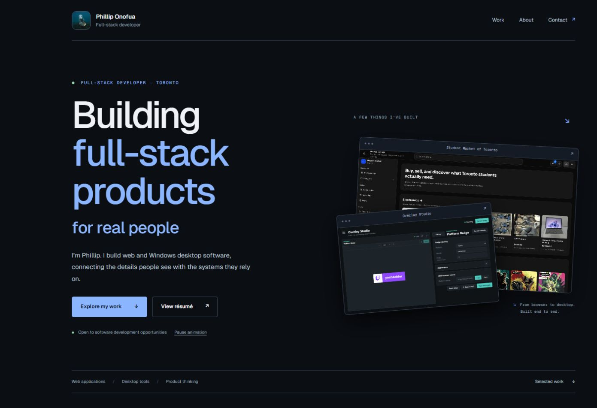

# Phillip Onofua | Full-Stack Developer Portfolio

A responsive portfolio presenting my full-stack web, Windows desktop, and product-development work.

[View the live portfolio](https://philliponofua.vercel.app) · [Download my résumé](https://philliponofua.vercel.app/assets/phillip-onofua-resume.pdf)



## Overview

This repository contains the source for my personal portfolio. The homepage pairs a letter-by-letter animated headline with real product previews, direct résumé access, and two featured projects. Each project links to a dedicated case study with implementation details, real interface captures, and clear status information; the Receipt Splitter concept appears separately as work in exploration.

The portfolio is intentionally lightweight: it uses static HTML, CSS, and JavaScript, has no runtime dependencies, and deploys directly from the `main` branch.

## Featured work

### Student Market of Toronto

An end-to-end student marketplace connecting catalogue discovery, listing management, messaging, profiles, media storage, and protected moderation workflows.

The case study opens with the working interface, a summary of the problem and my contribution, and grouped galleries covering marketplace, messaging, profiles, administration, mobile interfaces, and the data model. The engineering sections explain request-scoped authentication, bounded server-rendered queries, recoverable listing writes, realtime communication, and auditable report review. An expandable technical-notes section preserves the deeper implementation detail.

- **Role:** Team lead and full-stack developer
- **Stack:** Next.js, React, Supabase, PostgreSQL, Tailwind CSS, and Vercel
- [Open the live project](https://student-market-of-toronto.vercel.app)
- [View the source code](https://github.com/EdoiseO/student-market-of-toronto)
- [Read the engineering case study](https://philliponofua.vercel.app/student-market.html)

### Overlay Studio

A Windows desktop application for managing reusable overlay instances, customizing their appearance, previewing live data, and preparing browser-source URLs for OBS.

The case study shows the instance library, live customizers, Windows media integration, grouped social overlays, persistent settings, and a recorded product demonstration.

- **Role:** Product designer and developer
- **Stack:** Python, JavaScript, aiohttp, WebSockets, WebView2, and OBS Studio
- **Status:** Working production application in active development
- [Explore how Overlay Studio works](https://philliponofua.vercel.app/overlay-studio.html)

### Receipt Splitter

A work-in-progress mobile product concept for assigning shared receipt items, tax, and tip and producing clear totals for each person.

The project page separates the concept from finished work and documents the problem, proposed verification flow, open technical decisions, and next development milestones.

- **Status:** Concept and workflow definition
- [Review the Receipt Splitter plan](https://philliponofua.vercel.app/receipt-splitter.html)

## Portfolio features

- Dark-only, responsive editorial layout with clear navigation
- **Off the clock:** an interactive 3D comic collection with a movable lid, glossy sleeves, separate backing boards, verified rear artwork, close-up rotation, and a gentle hover/glow
- Original letter-by-letter hero animation, product previews, and prominent résumé access
- Animation pause control, reduced-motion support, and a readable fallback without JavaScript
- Two featured projects using real product captures, with concepts presented separately
- Dedicated case-study pages with project-specific metadata and social previews
- Product-first Student Market case study with expandable technical notes
- Student Market workflow galleries with thumbnails, image zoom, and full-size viewing
- Overlay Studio screenshots and an embedded product demo
- Semantic HTML, skip links on the refreshed pages, visible keyboard focus, descriptive alternative text, and reduced-motion support
- Downloadable résumé, direct contact links, privacy policy, and terms of use

## Built with

- HTML5
- CSS3
- Vanilla JavaScript
- HTML Dialog API
- Self-hosted Three.js for the Off the clock collection
- Vercel

There is no package installation or build step. All required fonts, images, logos, scripts, and media are committed with the site.

## Run locally

```bash
git clone https://github.com/EdoiseO/phillip_onofua.git
cd phillip_onofua
python3 -m http.server 8000
```

Open [http://localhost:8000](http://localhost:8000).

## Repository structure

```text
.
├── index.html                         # Portfolio homepage
├── off-the-clock/                     # Self-contained 3D comic collection
├── student-market.html                # Student Market engineering case study
├── overlay-studio.html                # Overlay Studio product case study
├── receipt-splitter.html              # Work-in-progress product plan
├── privacy.html                       # Privacy policy
├── terms.html                         # Terms of use
├── assets/
│   ├── styles.css                     # Base presentation styles
│   ├── overrides.css                  # Shared case-study and supporting-page styles
│   ├── home.css                       # Self-contained responsive homepage styles
│   ├── hero-motion.js                 # Letter animation and motion preferences
│   ├── case-study-refresh.css         # Student Market product-first layout and technical notes
│   ├── student-market-gallery.js      # Student Market gallery and zoom interactions
│   ├── student-market-*.{png,jpg}     # Desktop, mobile, admin, and data-model captures
│   ├── overlay-studio-*.png           # Overlay Studio interface captures
│   ├── overlay-studio-demo.webm       # Recorded Overlay Studio demonstration
│   ├── tech-logos/                    # Self-hosted technology brand marks
│   ├── portfolio-preview.jpg          # README and social preview image
│   └── phillip-onofua-resume.pdf      # Downloadable résumé
└── README.md
```

## Deployment

Vercel deploys the production site from the `main` branch.

### Browser security

`vercel.json` applies a Content Security Policy, MIME-sniffing and framing protection, a referrer policy, and restrictions on unused browser permissions to every route. Vercel supplies HSTS. Scripts, styles, fonts, media, and connections are same-origin; image textures may also use data/blob URLs. The sole inline script is the hash-approved Three.js import map. If that map changes, update its SHA-256 in the policy. No `unsafe-inline` or `unsafe-eval` exception is required. Browser styling uses CSSOM properties rather than inline style blocks.

Run `node --test security-headers.test.mjs off-the-clock/stickers.test.mjs` to check the import-map hash, HTML scripts, headers, and sticker boundaries. A plain Python static server does not apply Vercel headers, so verify the response headers and browser console on a deployment too.

The October 22, 2026 advisory check found no GitHub advisory matches for the vendored Three.js `0.186.0` (r186). [CVE-2020-28496](https://github.com/advisories/GHSA-fq6p-x6j3-cmmq) affects versions below `0.125.0`; [CVE-2022-0177](https://github.com/advisories/GHSA-7vvq-7r29-5vg3) is withdrawn and listed versions below `0.137.0`. This is a point-in-time advisory check, not a guarantee against undisclosed vulnerabilities. The vendored files are not covered by npm audit; recheck advisories when updating them.

Technology brand marks are sourced from [Devicon](https://devicon.dev) and [Simple Icons](https://simpleicons.org). The document and external-link symbols are from [Bootstrap Icons](https://icons.getbootstrap.com). All trademarks belong to their respective owners.

## Contact

- [GitHub](https://github.com/EdoiseO)
- [Email](mailto:philliponofua@gmail.com)

## Off the clock

The collection at `/off-the-clock/` is imported from the approved Short Box prototype, commit `241a5afaba0734fc72a39c3aa32fdd413fb31f9e`. Its 24 editions, cover sources, physical model, sleeve interactions, and reduced-motion support are preserved. The page and all textures, fonts, and Three.js modules are served from this repository; the homepage does not load the 3D assets.

Collection metadata is a saved snapshot. It includes no inventory order details or prices. Rear imagery is verified for 22 of 24 entries (21 actual comic backs and one mystery-bag wrapper); Ben 10 #2 Cover F packaging and incoming Absolute Green Arrow #6 remain clearly marked unavailable. Artwork remains credited to its original sources in `off-the-clock/comics.js`; the Three.js license is included in `off-the-clock/vendor/THREE-LICENSE.txt`.
